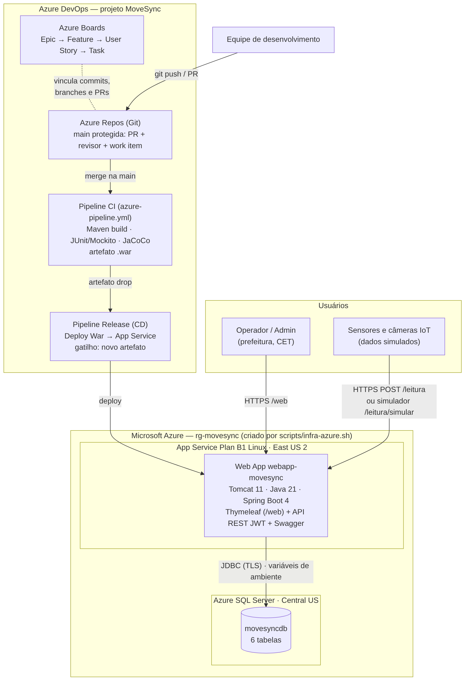
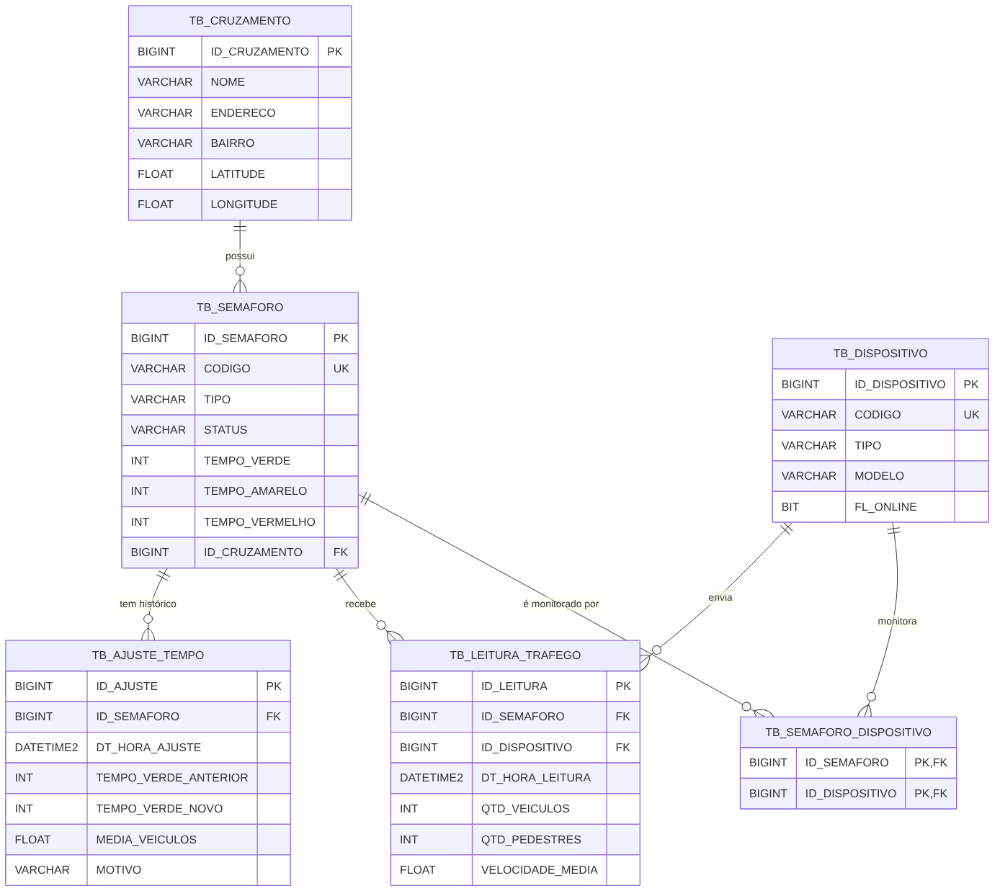

# 🚦 MoveSync — Semáforos inteligentes com IoT

> Global Solution 2026/2 · **CitizenTech** · FIAP — 2º ano ADS (turma 2TDSPO)
> Disciplina: **DevOps Tools & Cloud Computing** (solução Java implantada no Azure com Azure DevOps)

## 📌 Descrição da solução

O cidadão perde horas paradas em semáforos com **tempo fixo**, que não enxergam o trânsito real: o verde fica aberto para uma rua vazia enquanto a outra acumula fila. O **MoveSync** liga **sensores e câmeras IoT** aos semáforos de cada cruzamento, registra o fluxo de veículos e pedestres e **recalcula o tempo de verde** de acordo com o movimento real.

Este repositório contém a **API REST + painel web em Java (Spring Boot 4)** que faz a gestão da malha:

- **Cruzamentos** monitorados (endereço, bairro, coordenadas);
- **Semáforos** de cada cruzamento (tipo veicular/pedestre, status, tempos de verde/amarelo/vermelho);
- **Dispositivos IoT** (câmeras, laços indutivos, sensores de presença) vinculados aos semáforos (N:N);
- **Leituras de tráfego** enviadas pelos dispositivos;
- **Ajustes de tempo**: o MoveSync usa a média das 5 últimas leituras e aplica a regra
  `verde = 15 s + 1,5 s × média de veículos`, sempre entre **15 s e 90 s**, guardando o histórico.

> ⚠️ **Os dados de IoT são fictícios.** Não há hardware real: as leituras vêm do **simulador** (`POST /leitura/simular` ou botão *Simular leituras* no painel) e dos dados de exemplo do `scripts/script-bd.sql`.

## 💼 Benefícios para o cidadão e para a cidade

- **Menos tempo parado** no semáforo: o verde acompanha o fluxo real de cada via.
- **Menos poluição e combustível** gastos com o carro parado em marcha lenta.
- **Pedestres** atendidos por semáforos próprios, com o ciclo ajustado pelo movimento de pessoas.
- **Manutenção mais rápida**: semáforos em manutenção e sensores offline ficam visíveis no painel.
- **Decisão com dados**: o histórico de leituras e ajustes mostra onde o trânsito mais trava.

## 🏗️ Arquitetura macro



| Legenda | O que é |
|---|---|
| **Azure Boards** | Epic → Features → User Stories → Tasks; cada task é vinculada a branch, commits e PR |
| **Azure Repos** | Código-fonte (Git). Branch `main` protegida: PR obrigatório, revisor, work item vinculado |
| **Pipeline CI** | `azure-pipeline.yml`: roda a cada merge na `main` — build Maven, testes JUnit/Mockito, cobertura JaCoCo, publica o `.war` |
| **Pipeline Release** | Disparada automaticamente por novo artefato do CI; faz o deploy do `.war` no Web App |
| **Web App** | App Service Linux B1 (East US 2), runtime **Tomcat 11 / Java 21** |
| **Azure SQL** | Banco `movesyncdb` (Basic) no Central US; credenciais só em variáveis de ambiente |
| **Dispositivos IoT** | Fictícios: o simulador gera as leituras |

Fontes dos diagramas: [`docs/arquitetura.mmd`](docs/arquitetura.mmd) e [`docs/der.mmd`](docs/der.mmd).

## 🗃️ Banco de dados (6 tabelas)



| Tabela | Descrição |
|---|---|
| `TB_CRUZAMENTO` | Cruzamentos monitorados |
| `TB_SEMAFORO` | Semáforos (FK cruzamento) |
| `TB_DISPOSITIVO` | Sensores e câmeras IoT |
| `TB_SEMAFORO_DISPOSITIVO` | Relação N:N semáforo × dispositivo (máx. 4 por semáforo) |
| `TB_LEITURA_TRAFEGO` | Leituras (FK semáforo + dispositivo) |
| `TB_AJUSTE_TEMPO` | Histórico dos ajustes de tempo de verde (FK semáforo) |

DDL completo + dados fictícios: [`scripts/script-bd.sql`](scripts/script-bd.sql).

## 🧰 Tecnologias

Java 21 · Spring Boot 4.0.6 (Web MVC, Data JPA, Validation, Security, HATEOAS, Thymeleaf) · JWT · springdoc OpenAPI (Swagger) · Azure SQL (SQL Server) · Maven · JUnit 5 + Mockito · JaCoCo · Azure App Service (Tomcat 11) · Azure DevOps (Boards, Repos, Pipelines) · Azure CLI.

## 📁 Estrutura do repositório

```
MoveSync/
├── azure-pipeline.yml          # Pipeline de CI (YAML) na raiz
├── README.md
├── docs/                       # arquitetura e DER (png + fonte mermaid), coleção Postman
├── scripts/
│   ├── infra-azure.sh          # Azure CLI: cria RG, Azure SQL, Plano, Web App e variáveis
│   ├── delete-infra.sh         # Azure CLI: remove tudo
│   ├── script-bd.sql           # DDL das 6 tabelas + dados fictícios
│   └── variaveis.env.example   # modelo das variáveis secretas (o .env real não é versionado)
└── movesync/                   # projeto Java (Maven)
    ├── pom.xml
    └── src/
        ├── main/java/br/com/fiap/movesync/
        │   ├── entity · dto · mapper · repository · services
        │   ├── controllers (REST) · controllers/web (Thymeleaf)
        │   ├── assemblers (HATEOAS) · security (JWT) · config · exceptions · enums
        └── test/java/.../services  # testes unitários (rodam no CI)
```

## ☁️ 1. Provisionamento da infraestrutura (Azure CLI)

No **Azure Cloud Shell (Bash)**, dentro do repositório clonado:

```bash
export RM="562975"                       # RM do representante (nomes globais únicos)
export SQL_ADMIN_PASSWORD='<senha-forte-do-banco>'
export ADMIN_PASSWORD='<senha-do-admin-da-aplicacao>'
export OPERADOR_PASSWORD='<senha-do-operador>'

bash scripts/infra-azure.sh
```

O script cria, em ordem: Resource Group `rg-movesync` → Azure SQL `sqlserver-movesync-rm<RM>` + banco `movesyncdb` + firewall → plano `plan-movesync` (B1 Linux) → Web App `webapp-movesync-rm<RM>` (TOMCAT 11 / Java 21) → libera publicação SCM → grava as **variáveis de ambiente** do Web App → executa o `script-bd.sql`.

| Variável de ambiente (Web App) | Uso |
|---|---|
| `SPRING_DATASOURCE_URL` / `_USERNAME` / `_PASSWORD` | Conexão com o Azure SQL |
| `JWT_SECRET` | Assinatura dos tokens (gerado aleatoriamente pelo script) |
| `ADMIN_USERNAME` / `ADMIN_PASSWORD` | Usuário administrador |
| `OPERADOR_USERNAME` / `OPERADOR_PASSWORD` | Usuário operador |

> Nenhuma senha fica no código: o `application.properties` só lê variáveis de ambiente.
> Para remover tudo depois da apresentação: `bash scripts/delete-infra.sh`.

## 🔁 2. Azure DevOps (Boards, Repos, Pipelines)

1. **Projeto**: `MoveSync`, privado, Git, processo **Agile**. Professor convidado como *Basic* (organização) e *Project Administrators* (projeto).
2. **Repos**: importar este repositório. Em *Branches → main → Branch policies*:
   - *Require a minimum number of reviewers* = 1 (permitir aprovar as próprias alterações — simulação);
   - *Check for linked work items* = Required;
   - *Automatically included reviewers* = RM do representante.
3. **Boards**: Epic *MoveSync – Semáforos inteligentes em nuvem* → Features → User Stories → Tasks. Cada task gera uma branch (`feature/<id>-descricao`), commits com `#<id>` e PR vinculando o work item.
4. **Pipeline CI**: *Pipelines → New pipeline → Azure Repos Git → Existing YAML* → `/azure-pipeline.yml`. Roda **somente após o merge na `main`** (`trigger: main`, `pr: none`). Etapas: Java 21 → cache Maven → `mvn clean verify` (testes) → publica testes (JUnit) e cobertura (JaCoCo) → publica artefato `drop` (`.war` + scripts).
5. **Pipeline Release (CD)**: *Releases → New → Azure App Service deployment*:
   - Artefato: build do CI, com **Continuous deployment trigger** ligado (⚡);
   - Task *Azure App Service deploy*: *Web App on Linux*, app `webapp-movesync-rm<RM>`, pacote `$(System.DefaultWorkingDirectory)/**/*.war`, **Runtime Stack `TOMCAT|11.0-java21`**;
   - Variáveis da release: `webAppName`, `resourceGroup` (sem segredos).

## 🔐 Acesso

| URL | Descrição |
|---|---|
| `https://webapp-movesync-rm<RM>.azurewebsites.net/web/login` | Painel web (Thymeleaf) |
| `https://webapp-movesync-rm<RM>.azurewebsites.net/swagger-ui.html` | Swagger da API |
| `POST /auth/login` | Gera o token JWT (`Authorization: Bearer <token>`) |

Perfis: **admin** (tudo) e **operador** (leituras, simulação e ajustes; consulta cruzamentos/semáforos/dispositivos). As senhas são as definidas nas variáveis de ambiente.

## 📡 API REST — CRUD em JSON

Todas as rotas (exceto login e Swagger) exigem `Authorization: Bearer <token>`.

### Login
```http
POST /auth/login
```
```json
{ "username": "admin", "password": "<ADMIN_PASSWORD>" }
```

### Cruzamento — `/cruzamento`
| Operação | Método e rota |
|---|---|
| Create | `POST /cruzamento` |
| Read | `GET /cruzamento` · `GET /cruzamento/{id}` · `GET /cruzamento/nome/{nome}` · `GET /cruzamento/bairro/{bairro}` |
| Update | `PUT /cruzamento/{id}` |
| Delete | `DELETE /cruzamento/{id}` (bloqueado se houver semáforos) |

```json
{
  "nome": "Av. Faria Lima x R. dos Pinheiros",
  "endereco": "Av. Brig. Faria Lima, 2232",
  "bairro": "Pinheiros",
  "latitude": -23.5675,
  "longitude": -46.6936
}
```

### Semáforo — `/semaforo`
| Operação | Método e rota |
|---|---|
| Create | `POST /semaforo` |
| Read | `GET /semaforo` · `GET /semaforo/{id}` · `GET /semaforo/codigo/{codigo}` · `GET /semaforo/status/{ATIVO\|INATIVO\|MANUTENCAO}` · `GET /semaforo/cruzamento/{idCruzamento}` |
| Update | `PUT /semaforo/{id}` · `PATCH /semaforo/{id}/status/{status}` |
| Delete | `DELETE /semaforo/{id}` |
| Vínculo N:N | `POST /semaforo/{idSemaforo}/dispositivo/{idDispositivo}` · `DELETE /semaforo/{idSemaforo}/dispositivo/{idDispositivo}` |
| Ajuste | `POST /semaforo/{id}/ajustar-tempo` |

```json
{
  "codigo": "SEM-010",
  "tipo": "VEICULAR",
  "status": "ATIVO",
  "tempoVerde": 30,
  "tempoAmarelo": 4,
  "tempoVermelho": 30,
  "idCruzamento": 1
}
```

### Dispositivo IoT — `/dispositivo`
| Operação | Método e rota |
|---|---|
| Create | `POST /dispositivo` |
| Read | `GET /dispositivo` · `GET /dispositivo/{id}` · `GET /dispositivo/tipo/{CAMERA\|SENSOR_INDUTIVO\|SENSOR_PRESENCA}` · `GET /dispositivo/semaforo/{idSemaforo}` |
| Update | `PUT /dispositivo/{id}` |
| Delete | `DELETE /dispositivo/{id}` (bloqueado se vinculado ou com leituras) |

```json
{
  "codigo": "CAM-010",
  "tipo": "CAMERA",
  "modelo": "Câmera fictícia MS-CAM v1",
  "online": true
}
```

### Leitura de tráfego — `/leitura`
| Operação | Método e rota |
|---|---|
| Create | `POST /leitura` · `POST /leitura/simular?quantidade=5` (gera leituras fictícias) |
| Read | `GET /leitura` · `GET /leitura/{id}` · `GET /leitura/semaforo/{id}` · `GET /leitura/dispositivo/{id}` · `GET /leitura/periodo?inicio=...&fim=...` |
| Update | `PUT /leitura/{id}` |
| Delete | `DELETE /leitura/{id}` |

```json
{
  "idSemaforo": 1,
  "idDispositivo": 1,
  "dataHora": "2026-11-18T08:15:00",
  "qtdVeiculos": 42,
  "qtdPedestres": 6,
  "velocidadeMedia": 23.5
}
```
> O dispositivo precisa estar **online** e **vinculado** ao semáforo. `dataHora` é opcional (vazio = agora).

### Ajuste de tempo — `/ajuste` (somente leitura; criado por `POST /semaforo/{id}/ajustar-tempo`)
`GET /ajuste` · `GET /ajuste/{id}` · `GET /ajuste/semaforo/{idSemaforo}`

Resposta de exemplo do ajuste:
```json
{
  "id": 7,
  "idSemaforo": 1,
  "codigoSemaforo": "SEM-001",
  "dataHora": "2026-11-18T08:20:11",
  "tempoVerdeAnterior": 30,
  "tempoVerdeNovo": 72,
  "mediaVeiculos": 37.0,
  "motivo": "Fluxo alto: verde aumentado",
  "variacao": 42
}
```

A coleção Postman está em [`docs/MoveSync.postman_collection.json`](docs/MoveSync.postman_collection.json).

## 🧪 Testes automatizados

Testes unitários (JUnit 5 + Mockito) dos services, sem depender do banco, executados no CI a cada merge:

| Classe | O que valida |
|---|---|
| `CruzamentoServiceTest` | CRUD e bloqueio de exclusão com semáforos |
| `SemaforoServiceTest` | Código único/normalizado, status padrão, vínculo N:N e limite de dispositivos |
| `DispositivoServiceTest` | Código único, online por padrão, exclusão bloqueada |
| `LeituraTrafegoServiceTest` | Dispositivo vinculado e online, data automática, período válido |
| `AjusteTempoServiceTest` | Regra do verde (base, fator, mínimo e máximo), semáforo ativo, histórico |
| `SimuladorIotServiceTest` | Geração de dados fictícios só para semáforos com sensor online |

Rodar localmente: `cd movesync && ./mvnw clean verify` (relatório de cobertura em `target/site/jacoco/index.html`).

## 🎬 Roteiro do vídeo (checklist)

1. README: solução, arquitetura e legenda.
2. Portal Azure: recursos criados pelo `infra-azure.sh` (RG, SQL, plano, Web App, variáveis).
3. Boards: criar nova task.
4. Repos: nova branch a partir da task → alteração no **código-fonte** (ex.: um texto do `templates/home.html` ou a regra em `AjusteTempoService`) → commit `#<id>` → PR → merge na `main`.
5. Pipelines: CI rodando sozinho (etapas, **testes** e **artefato**), Release disparada automaticamente.
6. App em nuvem mostrando a alteração.
7. CRUD de pelo menos duas tabelas (ex.: Cruzamento e Semáforo) e conferência **direto no banco com `SELECT`** (Query editor do Azure SQL).
8. Task concluída mostrando os links (branch, commits, PR, build).

## 👥 Equipe

| Nome | RM |
|---|---|
| Rodrigo Tiezzi | RM562975 |
| _(integrante)_ | RM_____ |
| _(integrante)_ | RM_____ |
